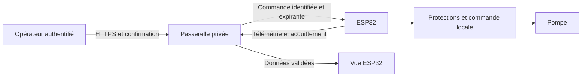

# Architecture de Floréol

## Application de démonstration

React et TypeScript organisent les parcours. La navigation par fragment fonctionne sous un sous-chemin GitHub Pages. Three.js charge le GLB à la demande. Les illustrations du jardin et de la station proviennent de la scène Blender V3. Les bibliothèques de rapport et les modules de supervision sont chargés séparément. Les polices sont hébergées avec le site.

Le moteur central porte l’heure simulée, les paramètres, le scénario, le volume, le cycle courant, les échantillons, le calendrier et les événements. Les vues React utilisent `useSyncExternalStore`. L’état enregistré reste dans le navigateur. Les exports permettent de le transférer. Les réglages de capacité nécessitent un volume initial explicite. Le passage à 70 Wc modifie la nouvelle référence photovoltaïque. Les anciens cycles gardent leurs caractéristiques d’origine.

### Mesures et estimations

| Grandeur | Relation |
|---|---|
| Niveau | volume / capacité × 100 |
| Volume utile | max(0, volume − réserve) |
| Volume d’un cycle | débit en L/min × durée en minutes |
| Autonomie hydraulique | volume utile / débit |
| Cycles complets | partie entière de volume utile / volume d’un cycle |
| Surface arrosable | volume × efficacité / dose en L/m² |
| Puissance PV estimée | Wc × irradiance / 1 000 × coefficient global |
| Puissance PV mesurée | tension × courant |
| Énergie | intégrale numérique de la puissance sur le temps en heures |

Le profil du simulateur utilise une journée illustrative en heure de Casablanca. Les séries de météo distante sont datées et indépendantes du scénario de jury. Les comparaisons PVGIS et PVsyst concernent des études énergétiques et non la puissance de la pompe à un instant donné. Le profil solaire illustratif n’est pas un algorithme astronomique de suivi des saisons.

### Parcours connecté

Les réglages de l’IoT, les limites du firmware et les essais à effectuer apparaissent dans la documentation de la passerelle. Une liaison physique sécurisée nécessite l’équipement et les références des capteurs. Le navigateur peut interroger un adaptateur HTTPS. Les outils du simulateur restent identifiés par leur propre provenance.

### Assistant

La version locale classe les requêtes par intention, applique les formules et lit le même état que le tableau de bord. Le choix thématique adapte les explications. Pour une IA générative, définir `LLM_URL`, `LLM_MODEL` et `LLM_API_KEY` uniquement dans l’environnement du serveur. L’URL doit accepter un POST HTTPS compatible avec le format chat-completions et renvoyer `choices[0].message.content`. Dans Floréol AI, ouvrir **Service génératif facultatif**, renseigner l’origine du backend et une session opérateur valable puis activer l’option. La question et le contexte de démonstration sont alors transmis. L’endpoint ne dispose d’aucun outil de commande. Les conditions et frais éventuels dépendent du fournisseur configuré ; aucun compte ni appel de modèle externe n’est nécessaire à cette livraison.